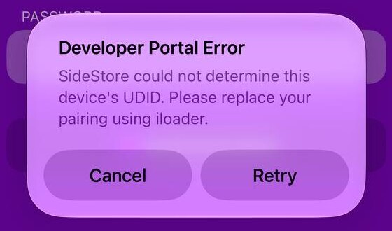
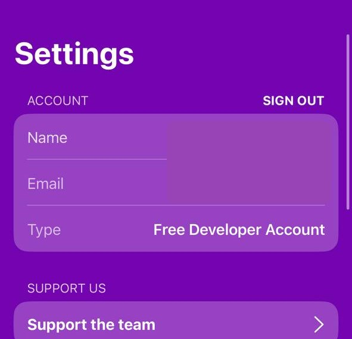
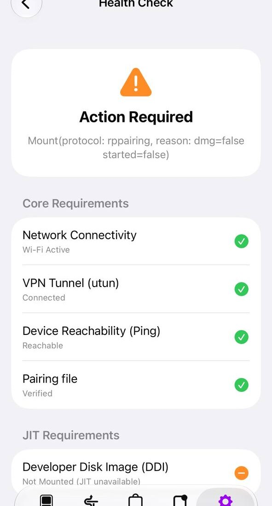

# iPhone → SideStore → KiiXY

Краткая инструкция по вашему проверенному сценарию. По присланным экранам: **iOS 27.0.1**, SideStore **0.7.0-20260911.328+6032424a**, бесплатный Apple Account. SideStore и KiiXY установлены; вход прошёл, pairing проверен. Имя и email на скриншоте скрыты.

## 1. Что нужно

- Для первичной установки или восстановления: Windows-ПК, USB-кабель, актуальный [iLoader](https://github.com/nab138/iloader/releases) и Apple Mobile Device Support.
- На iPhone включён **Developer Mode** и доступен интернет по Wi‑Fi. Точка доступа второго телефона подходит — домашний роутер не нужен.
- **LocalDevVPN** из App Store нужен для действий SideStore: установки IPA, обновления и refresh подписи. Для работы KiiXY он не нужен.

## 2. Установить SideStore через iLoader

1. На iPhone откройте **Settings → Privacy & Security → Developer Mode → On**, перезагрузите телефон и подтвердите включение.
2. Разблокируйте iPhone, подключите его к ПК кабелем и нажмите **Trust / Доверять**.
3. В iLoader выберите устройство, установите **SideStore Stable** и дождитесь окончания установки и размещения pairing-файла.
4. Если iOS попросит, подтвердите доверие профилю: **Settings → General → VPN & Device Management**.
5. Откройте LocalDevVPN и нажмите **Connect**. Затем откройте SideStore и войдите в тот же Apple Account, который использовался в iLoader.

Для любой операции SideStore нужны Wi‑Fi и LocalDevVPN. Выключить LocalDevVPN можно после завершения работы с SideStore.

## 3. Вход Apple Account: Anisette

В вашей сборке экран находится по пути **SideStore → Settings → User Customizations → Anisette Servers**.

В **Server List URL** укажите каталог, который у вас открылся:

`https://raw.githubusercontent.com/SideStore/anisette-servers/main/servers.json`

Нажмите **Retry Connection**, выберите **jkcoxson** и выключите **Enable Auto Rotation**. Проверенный endpoint: `https://mac-ani.jkcoxson.com/v3/client_info`.

Затем откройте **User Customizations → Anisette Client Configuration → Remote Server Sync** и выполните **Fetch → Save as Overrides**. Если нужно очистить данные Anisette, сбрасывайте **adi.pb**, а не pairing-файл. Пароль Apple Account и код подтверждения вводите только в SideStore.

- **CFNetwork -1001** — сетевой таймаут, сам по себе не означает неверный пароль.
- **Unable to Fetch News / The request timed out** — сбой ленты SideStore; он не мешает входу или KiiXY.

## 4. Pairing на iOS 27

Если появится **“SideStore could not determine this device’s UDID”**, это отдельная ошибка pairing, а не Apple Account или Anisette.

1. Сбрасывайте **SideStore → Settings → Reset Pairing File** только если эта ошибка действительно появилась.
2. Подключите разблокированный iPhone к Windows и подтвердите **Trust**.
3. Скачайте [idevice_pair из официального репозитория](https://github.com/jkcoxson/idevice_pair/releases/latest). Выберите iPhone → **Remote pairing** (не Lockdown) → **Create**. Запишите файл непосредственно в SideStore или сохраните его и выберите на телефоне.
4. В SideStore откройте **Settings → Health Check**. Если Wi‑Fi, VPN, Ping и **Pairing file: Verified** зелёные — pairing исправен, не сбрасывайте его повторно.

Для iOS 27 используйте чистый **Remote Pairing (RPPairing)**; не смешивайте его с Lockdown. Если pairing Verified, оранжевый **DDI Not Mounted / JIT unavailable** не мешает обычной установке и работе KiiXY.

## 5. Установить и запустить KiiXY

Для бесплатного Apple Account используйте [TgWsProxy-free.ipa](https://github.com/m0xvi/tg-ws-proxy-axy/releases/latest/download/TgWsProxy-free.ipa), не `TgWsProxy-vpn.ipa`.

1. Скачайте IPA в Safari.
2. В SideStore откройте **My Apps → + → Choose from Files** и выберите IPA в Downloads.
3. Откройте KiiXY, нажмите кнопку запуска, затем **«Открыть в Telegram»** и включите прокси в Telegram.

KiiXY создаёт прокси на этом же iPhone: Telegram → `127.0.0.1:1443` → KiiXY → интернет → Telegram. Это **не системный VPN**: другие приложения через KiiXY не идут. Самому KiiXY нужен интернет, но не LocalDevVPN.

В бесплатной сборке разрешите KiiXY геопозицию **«Всегда»**, если хотите работу в фоне: iOS использует это разрешение для удержания процесса активным. Возможен повышенный расход батареи; iOS всё равно может выгрузить приложение. Не смахивайте KiiXY из переключателя приложений, если оставляете прокси работать в фоне.

## 6. Подпись и обновления

- Подпись бесплатного Apple Account действует примерно **7 дней**. Background Refresh в SideStore может обновлять её автоматически, но iOS не гарантирует фоновый запуск. Надёжнее раз в **5–6 дней** подключить iPhone к Wi‑Fi/хотспоту, включить LocalDevVPN, открыть **My Apps**, выполнить **Refresh** и проверить, что срок снова около **7 DAYS**.
- Refresh обновляет **подпись**, а не версию KiiXY.
- KiiXY умеет проверять GitHub Releases и показать ссылку на IPA, но iOS не разрешает ему установить себя без подтверждения. Новую IPA импортируйте вручную через **SideStore → My Apps → +**, поверх старой. В вашей текущей установке источник KiiXY в SideStore не добавлен.
- Возможен повторный показ v2.0.16: GitHub-релиз называется **v2.0.16**, а внутренняя версия IPA может отображаться как **2.0.14 (214)**. Это расхождение номеров; не устанавливайте тот же файл повторно по кругу.

